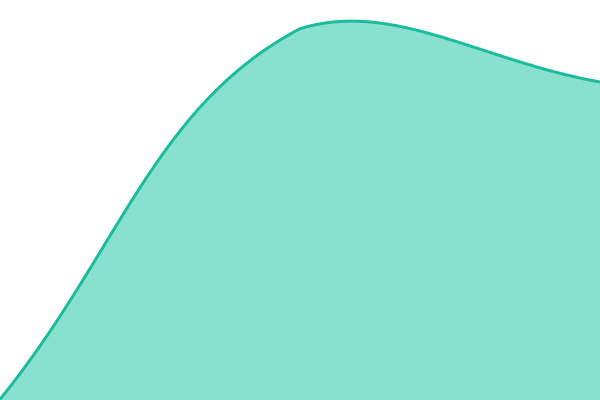
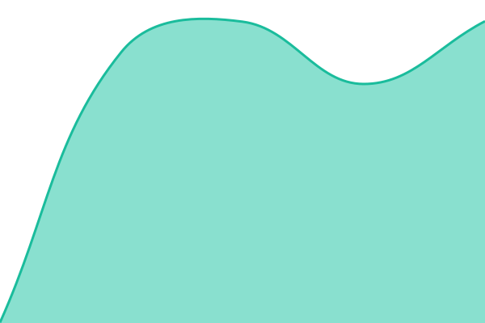
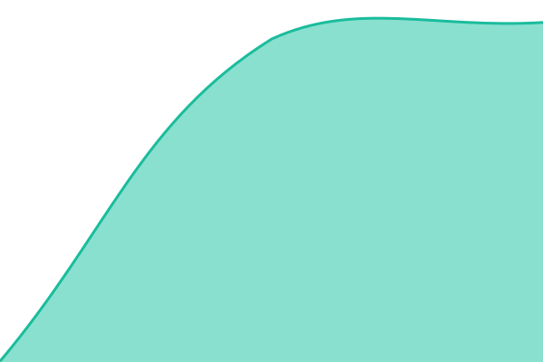
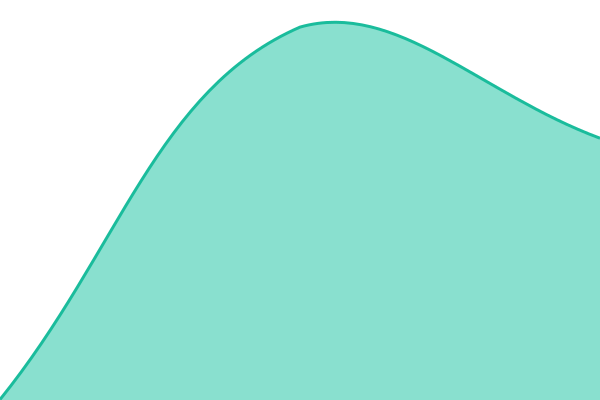
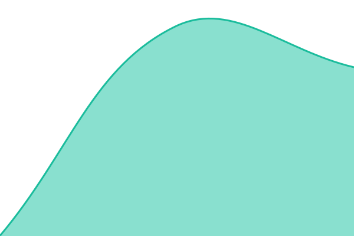

# [📈 Live Status](https://status.kumoyami.com): <!--live status--> **🟧 Partial outage**

This repository contains the open-source uptime monitor and status page for [Hostarys](https://status.kumoyami.com), powered by [Upptime](https://github.com/upptime/upptime).

With [Upptime](https://upptime.js.org), you can get your own unlimited and free uptime monitor and status page, powered entirely by a GitHub repository. We use [Issues](https://github.com/Hostarys/kumoyami-status/issues) as incident reports, [Actions](https://github.com/Hostarys/kumoyami-status/actions) as uptime monitors, and [Pages](https://status.kumoyami.com) for the status page.

<!--start: status pages-->
<!-- This summary is generated by Upptime (https://github.com/upptime/upptime) -->
<!-- Do not edit this manually, your changes will be overwritten -->
<!-- prettier-ignore -->
| URL | Status | History | Response Time | Uptime |
| --- | ------ | ------- | ------------- | ------ |
|  [Web](https://kumoyami.com/) | 🟩 Up | [web.yml](https://github.com/Hostarys/kumoyami-status/commits/HEAD/history/web.yml) | 

 1348ms
     
 | 

<a href="https://status.kumoyami.com/history/web">100.00%</a>
    

|  [Activación de licencias](https://licenses.kumoyami.com/v1/activate) | 🟩 Up | [activacion-de-licencias.yml](https://github.com/Hostarys/kumoyami-status/commits/HEAD/history/activacion-de-licencias.yml) | 

 557ms
     
 | 

<a href="https://status.kumoyami.com/history/activacion-de-licencias">100.00%</a>
    

|  [Activación de licencias (nombre antiguo)](https://licencias.kumoyami.com/v1/activate) | 🟥 Down | [activacion-de-licencias-nombre-antiguo.yml](https://github.com/Hostarys/kumoyami-status/commits/HEAD/history/activacion-de-licencias-nombre-antiguo.yml) | 

 561ms
     
 | 

<a href="https://status.kumoyami.com/history/activacion-de-licencias-nombre-antiguo">99.97%</a>
    

|  [Renovación de licencias](https://licenses.kumoyami.com/v1/renew) | 🟩 Up | [renovacion-de-licencias.yml](https://github.com/Hostarys/kumoyami-status/commits/HEAD/history/renovacion-de-licencias.yml) | 

 478ms
     
 | 

<a href="https://status.kumoyami.com/history/renovacion-de-licencias">100.00%</a>
    

|  [Cuentas e inicio de sesión](https://kumoyami.com/account) | 🟩 Up | [cuentas-e-inicio-de-sesion.yml](https://github.com/Hostarys/kumoyami-status/commits/HEAD/history/cuentas-e-inicio-de-sesion.yml) | 

 720ms
     
 | 

<a href="https://status.kumoyami.com/history/cuentas-e-inicio-de-sesion">100.00%</a>
    

|  [Entrar con KumoYami](https://accounts.kumoyami.com/.well-known/openid-configuration) | 🟩 Up | [entrar-con-kumo-yami.yml](https://github.com/Hostarys/kumoyami-status/commits/HEAD/history/entrar-con-kumo-yami.yml) | 

 587ms
     
 | 

<a href="https://status.kumoyami.com/history/entrar-con-kumo-yami">100.00%</a>
    

|  [Pagos](https://kumoyami.com/buy/pro) | 🟩 Up | [pagos.yml](https://github.com/Hostarys/kumoyami-status/commits/HEAD/history/pagos.yml) | 

 697ms
     
 | 

<a href="https://status.kumoyami.com/history/pagos">100.00%</a>
    

|  [Descargas (imagen Docker)](https://licenses.kumoyami.com/v1/registry/token?service=registry.kumoyami.com&scope=repository:kumoyami:pull) | 🟩 Up | [descargas-imagen-docker.yml](https://github.com/Hostarys/kumoyami-status/commits/HEAD/history/descargas-imagen-docker.yml) | 

 446ms
     
 | 

<a href="https://status.kumoyami.com/history/descargas-imagen-docker">100.00%</a>
    

|  [Descargas (paquetes NAS)](https://licenses.kumoyami.com/v1/packages) | 🟩 Up | [descargas-paquetes-nas.yml](https://github.com/Hostarys/kumoyami-status/commits/HEAD/history/descargas-paquetes-nas.yml) | 

 839ms
     
 | 

<a href="https://status.kumoyami.com/history/descargas-paquetes-nas">100.00%</a>
    

|  [Código de servidor](https://kumoyami.com/link) | 🟩 Up | [codigo-de-servidor.yml](https://github.com/Hostarys/kumoyami-status/commits/HEAD/history/codigo-de-servidor.yml) | 

 713ms
     
 | 

<a href="https://status.kumoyami.com/history/codigo-de-servidor">100.00%</a>
    

|  [Código de servidor (API)](https://licenses.kumoyami.com/v1/directory/BBBBBBBB) | 🟩 Up | [codigo-de-servidor-api.yml](https://github.com/Hostarys/kumoyami-status/commits/HEAD/history/codigo-de-servidor-api.yml) | 

 543ms
     
 | 

<a href="https://status.kumoyami.com/history/codigo-de-servidor-api">100.00%</a>
    

<!--end: status pages-->

[**Visit our status website →**](https://status.kumoyami.com)

## 📄 License

- Powered by: [Upptime](https://github.com/upptime/upptime)
- Code: [MIT](./LICENSE) © [Anand Chowdhary](https://anandchowdhary.com)
- Data in the `./history` directory: [Open Database License](https://opendatacommons.org/licenses/odbl/1-0/)
